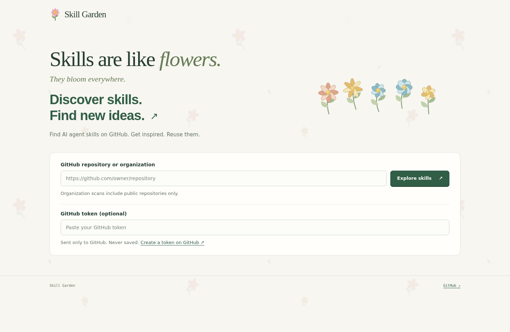
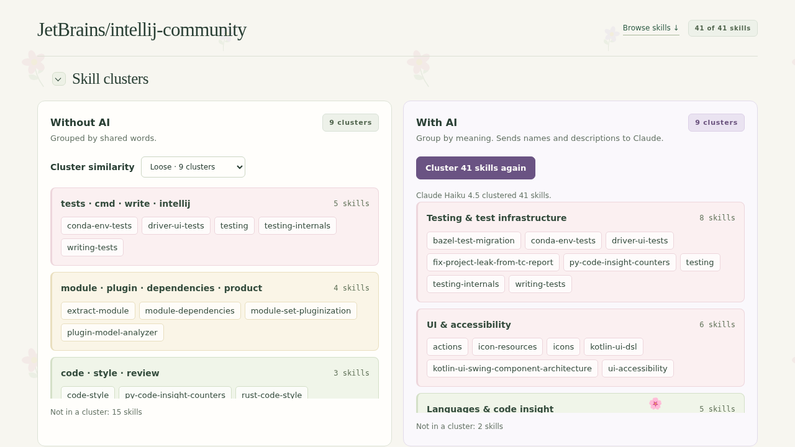
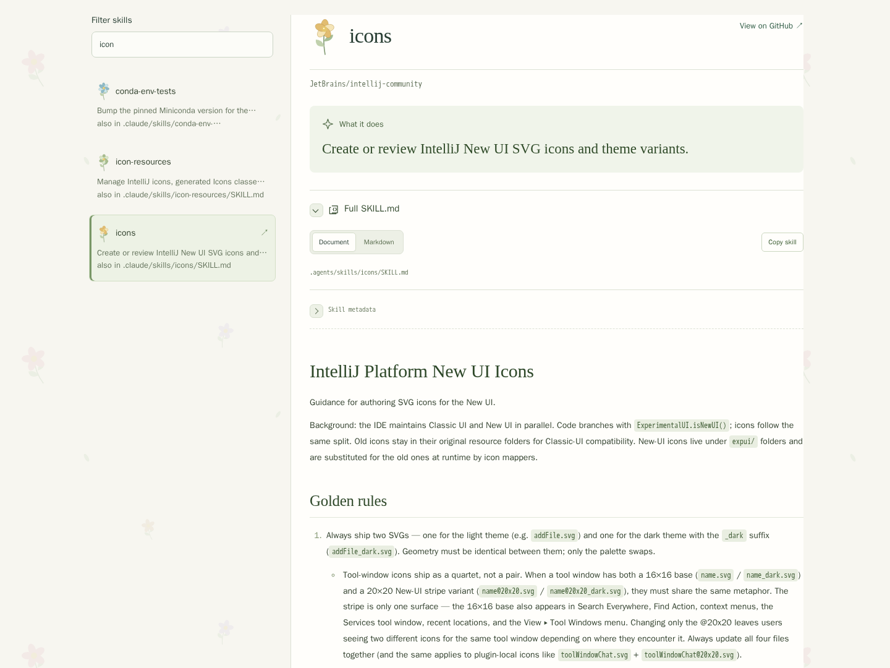

<div align="center">

# 🌸 Skill Garden

### Skills are like flowers. They bloom everywhere.

Discover, read, and reuse AI agent skills from GitHub repositories and organizations.

**[Get the HTML app](https://github.com/diffitask/skill-garden/blob/79619150f89d322ab38164c2540b25c233d281e9/skill-garden.html)** · **[Try it locally](#try-it-locally)** · **[GitHub](https://github.com/diffitask/skill-garden)**

No watering required.

</div>

https://github.com/user-attachments/assets/9ba3ab5b-7e74-4794-a2c8-fb6761654016

A skill is a `SKILL.md` file containing instructions for an AI agent. Skill Garden brings those files together so you can see what an agent can do, understand its instructions, and find ideas for your own workflows.

> The screenshots and **Get the HTML app** link show the saved Skill Garden design preview. The local app on `main` still uses the Skill Atlas name and interface; its portable file is [skill-atlas.html](skill-atlas.html).



## Pick a repository. See what grows.

Paste a GitHub repository or organization URL to discover its skills. Browse names and descriptions, filter the results, and follow links to the original instructions on GitHub. Organization scans cover public repositories, including forks and archived projects.

- **Discover** skills and search their names and descriptions.
- **Find connections** with shared-word clusters or optional AI grouping by meaning.
- **Read clearly** with a skill summary and the full original instructions.
- **Reuse what works** by taking useful instructions into your own agent workflows.



*The AI panel shows an illustrative response rendered by the application.*

## Your next idea might already be blooming.

Select a skill to read its description and original `SKILL.md`, with a link pinned to the scanned GitHub commit. The preview shown below includes a formatted document reader.



## Try it — one HTML file

1. Open **[skill-garden.html](https://github.com/diffitask/skill-garden/blob/79619150f89d322ab38164c2540b25c233d281e9/skill-garden.html)** in this repository and choose **Download raw file**.
2. Open the downloaded file in your browser.
3. Enter a GitHub repository or organization URL and choose **Explore skills**.

This downloads the saved design preview shown in the screenshots. Try [`JetBrains/intellij-community`](https://github.com/JetBrains/intellij-community) to explore the skills shown above.

The HTML app is self-contained: no installation or local server is needed. An internet connection is required to scan public GitHub sources. If GitHub limits your requests, wait and retry, or enter an optional GitHub token. Browser tokens are sent only to GitHub and kept in the current tab; they are never saved.

## Try it locally

Requires **Node.js 24 or later**.

```bash
npm ci
npm start
```

Open [127.0.0.1:3000](http://127.0.0.1:3000). Set `PORT` to use another port. The local server can also scan private repositories with `GITHUB_TOKEN`.

### Optional: group skills with AI

Install Claude Code and log in, then run `npm start` and choose **Cluster with AI**. The helper uses Claude Haiku 4.5 and sends skill names and descriptions to Claude.

To use AI from the downloaded HTML app, enter the pairing code printed by `npm start` in its **With AI** panel (expand **Connect your local AI helper** in the design preview). Keep the server running. Set `CLAUDE_BIN` if the CLI is outside your `PATH`.

<details>
<summary><strong>CLI, development, and tests</strong></summary>

The command-line entry point is `skill-atlas`:

```bash
./skill-atlas scan https://github.com/JetBrains/intellij-community
./skill-atlas scan https://github.com/JetBrains
```

It prints skill names, descriptions, and commit-pinned GitHub links. Set `GITHUB_TOKEN` for private repository access or higher API limits. Organization scans include public repositories only, including forks and archived repositories. User account URLs are not organization URLs.

Large repositories can return partial results when GitHub truncates a tree; warnings explain the scope. Failed repository scans preserve completed organization results. Incomplete CLI scans exit with status 1.

Rebuild the portable HTML after changing the UI or scanner:

```bash
npm run build:web
```

Run the checks:

```bash
npm test
npx playwright install --with-deps chromium
npm run test:browser
npm run typecheck
```

Browser integration tests exercise both the server and portable HTML with replayed GitHub responses.

[Specs](spec/) · [Development instructions](AGENTS.md) · [Test fixture](fixture/README.md)

</details>

---

<div align="center">

**Explore new skills. Grow your own garden.**

[github.com/diffitask/skill-garden](https://github.com/diffitask/skill-garden)

</div>
